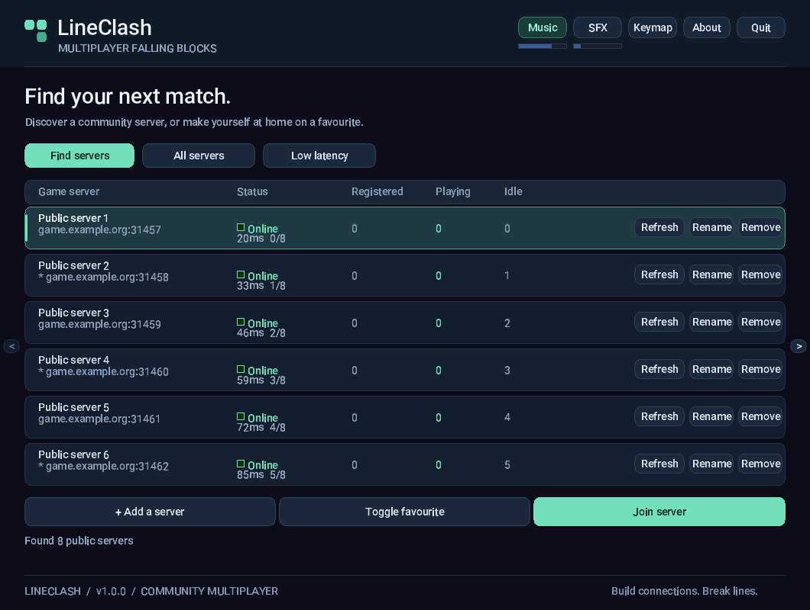

# Server discovery, match history and replays

## Native public browser

Set `LINECLASH_DIRECTORY_API=https://your-host/api/` before starting the GUI, then select **Find servers** in the server list. Downloads run on a background worker with verified TLS, no redirects, a bounded response and timeouts. The optional website shortcut still uses `LINECLASH_DIRECTORY_URL=https://your-host/directory/`.

The browser supports up to 64 saved/discovered endpoints (native hostnames up to 127 bytes), **All / Favourites / Recent / Open slots / Ping ≤100 ms** filters, latency and recent-played sorting. Latency is an approximate TCP/banner round trip, not gameplay latency. Unknown/offline latency sorts last. Open-slot filtering uses the operator-announced total capacity; absent capacity is unknown, not zero free slots. The **Favourite / unfavourite** button persists the chosen endpoint. Recent entries are recorded only after successful authentication.

Public discovery never supplies or sends account credentials. Selecting a new endpoint opens the connection form; saved credentials are reused only for that exact host/port and nickname. Discovery merges matching endpoints without replacing local names, passwords or favourites. Unused discoveries are transient. First-time users must enter credentials explicitly.

For isolated local tests only, `LINECLASH_DIRECTORY_ALLOW_LOCAL=1` allows discovery from loopback HTTP. Public HTTP is always rejected. Native discovery adds a libcurl dependency on macOS/Linux; Windows uses built-in WinHTTP. On macOS the system libcurl is used. Linux build dependencies are `libcurl4-openssl-dev` (Debian/Ubuntu), `libcurl-devel` (openSUSE/Fedora); corresponding runtimes must be available in installed clients.

## Competitive and casual history

New matches have a ranked candidate flag only when there are at least two humans and no active bots at round start. Manually stopped rounds are always casual. Solo/bot rounds and legacy records are casual, retained in history but excluded from the **ranked** public leaderboard. Ranked here means this eligibility rule, not verified tournament rules or a cheat-free certification. Natural draws remain ranked matches with no awarded win.

Every human participant has a linked game ID, per-match lines/specials/blocks, placement when observed, and win status. Zero placement means unknown (for example, a disconnected player), not a fabricated finishing position. Match completion finalizes disconnected players too. Public player histories are scoped by server and nickname; matching names on different servers are not merged. The website exposes recent 50-match profiles, match details, UTC duration and ranked/casual filters.

New matches store UTC epoch seconds as well as UTC text timestamps. Existing historical timestamps are preserved and labelled legacy; their timezone and ranking are not guessed. Run `php public-web/bin/manage.php migrate` on each website upgrade before enabling the updated registrar. Migrations are additive and repeatable.

A persistent random generation ID now belongs to the **gameplay database**, in `service_metadata`, rather than only the registrar state. Restarting or restoring the same game database preserves identity. Resetting delivery state safely replays the same remote IDs without duplicating games. Replacing the game database produces a new generation automatically, so reusing the delivery state cannot silently suppress games with reused numeric IDs. The first upgrade can adopt the old delivery identity to preserve existing remote history. Preserve both files in backups, and never run two registrars against the same server simultaneously.

## Registration health

The supervisor atomically writes a private `STATE.health.json` file (override with `--health PATH`). It reports the last successful announcement, failure count, pending batch count and actionable error guidance without credentials or payloads. `pending_is_lower_bound` marks the count as a lower bound rather than an exact queue length; it is not an exact queue length. The last success survives restarts.

```sh
python3 scripts/server_directory.py --show-health /var/lib/lineclashd/directory.sqlite3.health.json
```

403 errors point to server ID/token provisioning; 503 errors point to website/database configuration; connection/TLS failures point to URL, certificates or connectivity. All retry without blocking gameplay. The supervisor notices unexpected child exit promptly rather than waiting an entire heartbeat interval.

## Gameplay replays and inspection

Dedicated servers buffer public gameplay broadcasts in memory, then save the trace at round completion in the same SQLite transaction as final results. Authentication and chat are excluded by an allowlist. Each room is bounded to **2,048 events** (roughly 1 MiB); a trace that reaches the limit is explicitly marked partial. There are no replay SQLite writes on every game frame. A crash can lose the current unfinished trace.

The registrar compresses traces, includes their SHA-256, and uploads them with the match. Announcements are bounded to 2 MiB and selected into smaller batches; the website validates decompression limits, checksums, ordering and event types before committing. Retries cannot double-count results, player rows or replays. Legacy games have no trace and cannot gain a historical replay retroactively.

Open **Details / replay** from a recent match. The viewer verifies the original trace checksum before playback, supports play/pause, seeking, playback speed, board snapshots for all eight slots and JSON downloads. Times between snapshots show the last recorded board; this is not a frame-perfect video. Player names link to their server-scoped history.

Download and inspect a trace independently:

```sh
python3 scripts/verify_replay.py lineclash-replay.json
```

The verifier checks SHA-256, event sequence/times, allowed messages and board dimensions; it reports partial traces. Checksums detect altered/corrupted bytes, but a trusted server operator can fabricate a trace. There is no deterministic resimulation or authoritative anti-cheat proof in this format.

## Music controls

During a round, **F8 / F9 / F10** select previous track, pause/resume and next track without opening the player. These shortcuts are reserved while in a round, including watching after elimination. Menus remain title-only. Important enabled sound alerts temporarily reduce music to 35% and smoothly restore it without changing the saved music volume. Move/rotate sounds do not duck music.

## Verification

`make verify` covers native builds, offline release tools, protocol/auth/network tests, music/UI, and a real HTTP fixture for asynchronous native discovery. Added multiplayer cases cover host departure, concurrent disconnects, natural wins, stopped rounds, participant completion, replay privacy, and persistent identity across server restarts. With a disposable MariaDB configuration in `LINECLASH_WEB_CONFIG`, `make web-test` covers migrations, ranked filtering, player history, replay integrity, registration and shutdown. Windows runtime and installer checks still require a Windows host; cross-compilation alone is not runtime verification.


