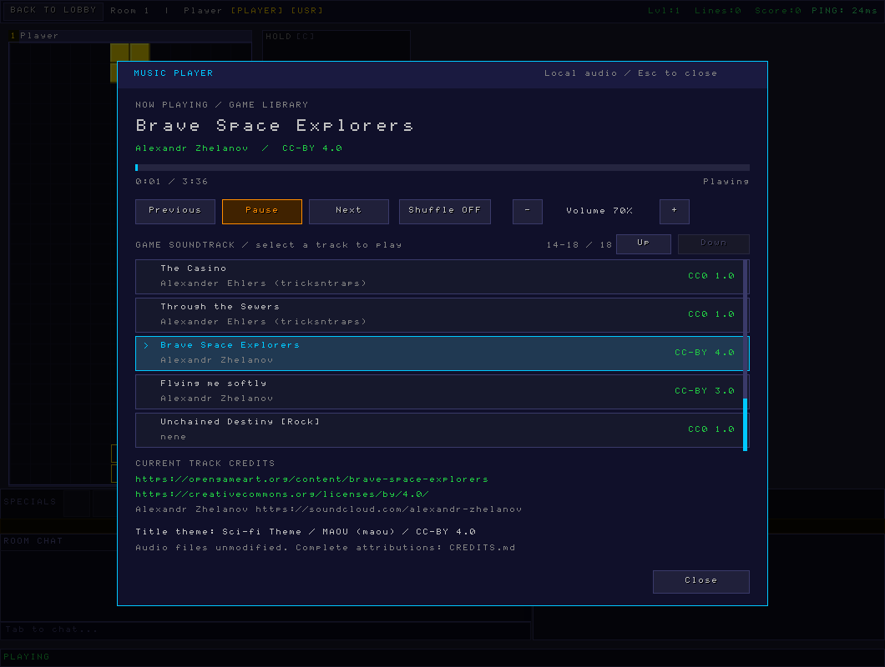

# LineClash soundtrack

The GUI includes one title theme and an 18-track game library. `tracks.json` records authors, source/download URLs, license links, original byte sizes and SHA-256 hashes. See [CREDITS.md](../CREDITS.md) for full attribution.

Sci-fi Theme by MAOU plays in the main menu and loops. Rounds use the game library, advancing automatically through tracks; shuffle is optional. Unchained Destiny plays its original opening followed by its loop as one selection, then advances. Sky Portal appears once. The original audio bytes are preserved; filenames are normalized.

Open **Music Player** beside Hold/Next during an active round. The player is unavailable in menus and waiting rooms; leaving a round closes it and returns to the title theme. Select tracks, scroll with the wheel/Up/Down, skip, pause, shuffle, adjust music volume or click the progress bar to seek. Left/Right skip and Space pauses while the player is open. Esc closes it. The game continues while the player is open. SFX controls remain separate. The current track's author, license, source link and requested attribution are displayed. About has paginated credits for the entire library.

The decoder worker streams MP3, WAV and Ogg into a bounded stereo buffer. No audio downloads or extra codec libraries are required at runtime. Music decoding does not run on the game loop or audio callback. SDL2's AudioStream handles sample-rate/channel conversion. Use SDL2 2.0.7 or newer.

Asset lookup supports the macOS bundle Resources/music directory, a sibling music directory near the executable (including the native ZIP's bin/../music layout), the development project's music directory and /usr/share/lineclash/music. `LINECLASH_MUSIC_DIR` can select another asset directory. Main-menu and playlist music honors the saved master music preference; shuffle and volume are saved too.

Run `python3 scripts/check_music.py` to verify credits/catalog consistency and every audio checksum. `--write-catalog` regenerates the compiled catalog after deliberate metadata changes. The source archive and native ZIP include the complete music directory and CREDITS.md. macOS and Linux packaging scripts copy the same assets and credits. The previous optional MOD filenames are no longer the bundled soundtrack.

During rounds F8/F9/F10 control previous/pause/next without opening the player. Important sound alerts temporarily duck music; move/rotate sounds do not. See [enhancements](../docs/ENHANCEMENTS.md).
